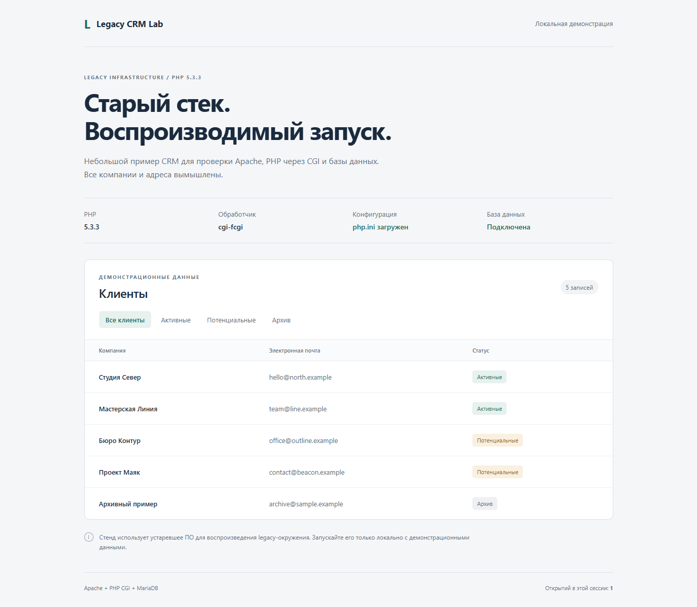
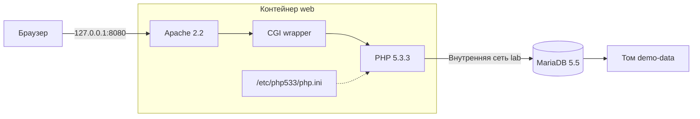

# Legacy PHP CRM Lab

[](https://github.com/ZERNOHKA/legacy-php-crm-lab/actions/workflows/smoke.yml)

Локальное окружение для старого PHP-приложения: **PHP 5.3.3, Apache/CGI и MariaDB 5.5**, сборка из исходников и автоматические проверки.

Проект вырос из задачи на практике: собрать PHP под параметры существующего сервера и запустить CRM. При настройке CGI обнаружилось, что CLI читает `php.ini`, а веб-запросы — нет. Из-за отсутствующего часового пояса появлялись предупреждения, затем ошибки сессий и заголовков.

Здесь этот опыт оформлен в самостоятельный демостенд. Вместо приложения организации — небольшая страница с вымышленными клиентами. Подробности задачи и границы выполненной работы — в [разборе](docs/case-study.md).



> PHP 5.3.3 и остальные компоненты устарели. Стенд предназначен только для локальных экспериментов с демонстрационными данными. Не публикуйте его в интернете.

## Запуск

Нужны Docker с Compose v2 и Linux-контейнеры. Архитектура — `linux/amd64`; на ARM нужна эмуляция.

```sh
git clone https://github.com/ZERNOHKA/legacy-php-crm-lab.git
cd legacy-php-crm-lab
docker compose up -d --build --wait --wait-timeout 180
```

Первая сборка скачивает архивные зависимости и компилирует PHP. После запуска откройте [http://127.0.0.1:8080](http://127.0.0.1:8080). Должны отображаться пять клиентов; фильтры обращаются к БД, счётчик открытий использует PHP-сессию.

Порт и локальные реквизиты можно изменить, скопировав `.env.example` в `.env`. Без этого используются демонстрационные значения из Compose. Порт сайта привязан к `127.0.0.1`; порт БД на хост не публикуется.

## Проверки

Базовая проверка требует только Python 3.9+:

```sh
docker compose exec -T web php -v
docker compose exec -T web php -m
docker compose exec -T web php /opt/lab/check-runtime.php
python scripts/smoke.py
```

В Linux используйте `python3`, если команда `python` отсутствует. Для другого порта передайте `--base-url http://127.0.0.1:8081`.

| Сценарий | Ожидаемый результат |
| --- | --- |
| CLI и CGI | PHP 5.3.3, нужные расширения |
| `GET /health` через `.htaccess` | HTTP 200, `ok: true`, `/etc/php533/php.ini`, `UTC` |
| MariaDB | Версия 5.5.x, пять демонстрационных записей |
| Фильтры | Все: 5, активные: 2, потенциальные: 2, архив: 1 |
| Сессия и кодировка | Счётчик сохраняется, кириллица отображается правильно |
| Закрытые и отсутствующие файлы | 403 для includes и прямого CGI, 404 для отсутствующего PHP-файла |

Браузерная проверка через Playwright:

```sh
python -m venv .venv
# Linux/macOS:
.venv/bin/pip install -r requirements-dev.txt
.venv/bin/playwright install chromium
.venv/bin/python scripts/ui-smoke.py
```

В Windows используйте `.venv\Scripts\pip.exe`, `.venv\Scripts\playwright.exe` и `.venv\Scripts\python.exe` вместо путей `.venv/bin/`. Для уже установленного Edge можно передать `--channel msedge` и не скачивать Chromium.

Скрипт проверяет страницу, фильтры, сессию, консоль и отсутствие горизонтального переполнения при размерах 1365×1000 и 390×844. Скриншоты сохраняются в `artifacts/ui/`.

[GitHub Actions](https://github.com/ZERNOHKA/legacy-php-crm-lab/actions) собирает образ, запускает стенд, проверяет синтаксис PHP, HTTP-сценарии и интерфейс в Chromium. Скриншоты доступны в артефакте `browser-screenshots`. Проверки относятся к этому примеру, а не ко всем функциям исходной CRM.

## Устройство стенда



- PHP собирается отдельно; компилятор и исходники не попадают в финальный образ. SHA-256 архива PHP закреплён в Dockerfile.
- Apache и PHP работают в одном контейнере. Wrapper явно передаёт `-c /etc/php533/php.ini`, не пробрасывает HTTP-аргументы в командную строку и блокирует прямой вызов CGI.
- Бинарные файлы находятся в `/opt/php533`, конфигурация — в `/etc/php533`. Apache не требуется доступ к `/root`.
- Healthcheck проверяет цепочку HTTP → Apache → CGI → PHP → БД. Проверять только CLI недостаточно: именно расхождение CLI и CGI было проблемой в исходной задаче.
- БД подключена только к внутренней сети `lab`. У web есть отдельная сеть `frontend` для публикации loopback-порта и исходящего доступа.

## Совместимость

Версия PHP и набор функций сборки сохранены. Пути установки адаптированы для Apache, CGI включён явно. `readline` проверяется только в CLI: в PHP 5.3.3 это расширение недоступно в CGI.

MariaDB закреплена на 5.5.64 вместо исходного серверного пакета 5.5.52. Итоговая конфигурация удалённого сервера не сохранилась: этот проект — публичная реконструкция, а не его точная копия. Корпоративный код, данные, доступы и переписка не включены. Сборка не использует старый архив `php533.tar`.

Архивные репозитории и теги базовых образов не гарантируют побитовую идентичность сборок. Сохранённые патчи OpenSSL и флаги компиляции нужны для совместимости со старым PHP.

## Остановка и диагностика

```sh
docker compose down
docker compose logs --tail 100 web db
```

Обычная остановка сохраняет данные. Если порт занят, измените `HTTP_PORT` в `.env`. После изменения приложения или конфигурации повторите запуск с `--build`.

SQL и реквизиты БД применяются при первом создании тома. Чтобы пересоздать демонстрационную БД:

```sh
docker compose down -v
docker compose up -d --build --wait --wait-timeout 180
```

`down -v` удаляет данные этого Compose-проекта. Используйте его только для ненужной демонстрационной БД.

## Источники

- [Архив PHP](https://museum.php.net/php5/) и [сроки поддержки](https://www.php.net/eol.php)
- [Apache: CGI](https://httpd.apache.org/docs/2.2/howto/cgi.html) и [Action](https://httpd.apache.org/docs/2.2/mod/mod_actions.html)
- [PHP: конфигурационный файл](https://www.php.net/manual/en/configuration.file.php)
